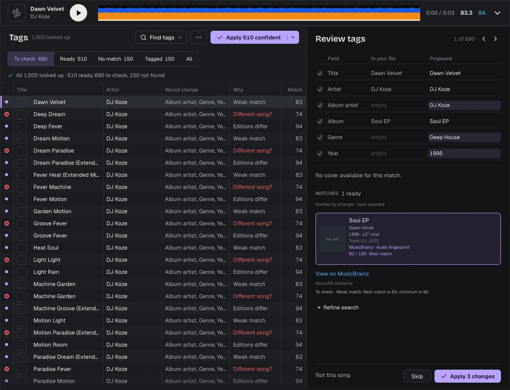
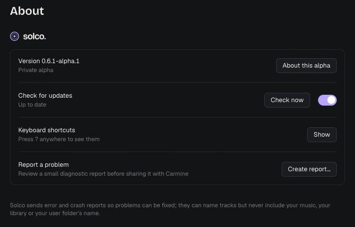
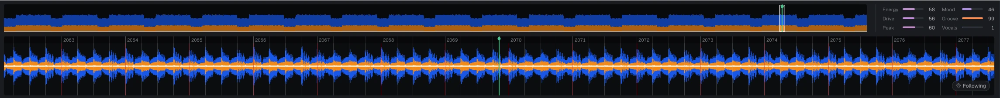

# Solco

Solco is the prep studio for DJs. It grids every track you add, keys it, hears
its genre and character, fixes its tags and files it into smart playlists. Then
it writes the USB drive your CDJs read, no rekordbox needed, or playlists with
cues and grids for Traktor and other DJ apps. Every analysis runs
on your own computer, and you can still do any of it by hand.

This is where Solco's builds, updates and support issues live. Learn more at
[getsolco.com](https://getsolco.com).



## Download

**[Download the latest release](https://github.com/crmne/solco-releases/releases)**
(the newest build is at the top of the list).

| Platform | File |
| --- | --- |
| macOS (Apple Silicon) | `solco-…-macos-arm64.dmg` |
| Windows | `solco-…-x86_64-pc-windows-msvc.msi` (installer) or the `.zip` (portable) |
| Linux, Debian and Ubuntu | `solco_…_amd64.deb` or `solco_…_arm64.deb` |
| Linux, Fedora | `solco-….x86_64.rpm` or `solco-….aarch64.rpm` |
| Linux, any distribution | `solco-…-x86_64-unknown-linux-gnu.tar.gz` or `solco-…-aarch64-unknown-linux-gnu.tar.gz` (portable) |

Solco is in private beta. Anyone can download it, and it works with a personal
licence key: join the waitlist at [getsolco.com](https://getsolco.com) and your key
comes by email. Activating it needs the internet once, then Solco works offline.
A key works on up to three of your computers and renews by itself while the beta
runs; builds don't expire. Keep a backup of your music and library, and use a
spare drive for your first exports.

Your licence key also turns on the playlist assistant. Sending it a message
shares your request and the titles and characteristics of the tracks it looks
up, never audio or file paths. Analysis and export work without it.

### Check your download

Each release includes `checksums.txt` with the SHA-256 of every file. Download it
next to your file, then:

- **Linux:** `sha256sum --check --ignore-missing checksums.txt`
- **macOS:** `shasum -a 256 solco-*.dmg`, and compare with the line in `checksums.txt`
- **Windows (PowerShell):** `Get-FileHash solco-*.msi`, and compare with the line in `checksums.txt`

## Linux

Install Solco from your package manager to get each new beta with your other
updates. Every route installs the official downloads from this page.

**Debian 13 or later, Ubuntu 24.04 or later:**

```sh
sudo wget -qO /etc/apt/sources.list.d/solco.sources https://github.com/crmne/solco-releases/raw/main/linux/apt/solco-beta.sources
sudo apt update && sudo apt install solco
```

**Fedora 40 or later:**

```sh
sudo curl -fsSLo /etc/yum.repos.d/solco.repo https://github.com/crmne/solco-releases/raw/main/linux/rpm/solco-beta.repo
sudo dnf install solco
```

dnf asks once to import Solco's package key. Its fingerprint is
`61A8 5B1F 7706 63CC D1A9  D262 5DF3 0EBB 7D46 44E7`.

**Arch Linux** ([AUR](https://aur.archlinux.org/packages/solco-bin)), with an
AUR helper such as `yay` or `paru`:

```sh
yay -S solco-bin
```

**NixOS and Nix** (with flakes enabled):

```sh
nix run github:crmne/solco-releases
nix profile add github:crmne/solco-releases
```

(Older Nix versions use `nix profile install`.) On NixOS, add the flake as an
input and `inputs.solco.packages.${pkgs.system}.solco` to
`environment.systemPackages`.

Update with `sudo apt upgrade`, `sudo dnf upgrade`, your AUR helper,
`nix profile upgrade --all` or `nix flake update solco`. How the repositories
work: [docs/linux-repositories.md](docs/linux-repositories.md).

## Updates

Solco checks this page for a newer release when it starts and once a day after
that. When one is out, a slim banner appears under the title bar. Nothing is
downloaded until you click **Download**. **Restart to update** then closes Solco
the usual way, asking about anything still running, and opens the new version.
If the new version does not start, the previous one comes back.

Every update is verified against Solco's publisher signature before it is
installed. Turn checks off, or check now, in **Settings › About**.

After each release's downloads, publisher signature and links have been verified,
older application releases and their downloads are removed. A new alpha replaces
older alphas while keeping the latest stable release available. Git tags and
version history remain. The [release retention policy](docs/release-retention.md)
describes these checks.

- The macOS app, the Windows installer and the portable Windows and Linux
  archives update themselves.
- Copies installed with apt, dnf, the AUR or Nix update through that package
  manager (see [Linux](#linux)). A DEB or RPM downloaded from this page updates
  by installing the new package from this page.
- When a release changes the bundled analysis models, its release notes ask
  portable copies to download the full archive once.



## System requirements

- **macOS:** 13.4 or later, on Apple Silicon. Intel Macs are not supported.
- **Windows:** 64-bit (x86-64).
- **Linux:** 64-bit x86-64 or ARM64.

Windows builds include `solco.com` beside `solco.exe`. Use the
companion for terminal commands, for example
`& "$env:LOCALAPPDATA\Programs\Solco\solco.com" list` in PowerShell. It waits
for completion and preserves output and exit codes. Update scripts that name
`solco.exe` explicitly to use `solco.com`; shortcuts still open `solco.exe`.
Keep both files together.

Analysis uses your graphics card when there is one (Metal on macOS, Direct3D 12
on Windows, Vulkan on Linux) and falls back to the processor otherwise. No CUDA
or ROCm is needed. Each download is about 136 to 147 MB, analysis models included.



## Feedback and support

- **Feedback:** click the Feedback icon at the top of the sidebar, beside
  Add a music folder and Settings. It starts a conversation with the Solco
  team, and replies appear in the same place. **Tell us**, next to anything
  that needs you, starts one with the error already filled in.
- **Bugs:** [open an issue](https://github.com/crmne/solco-releases/issues) with
  what you did, what you expected and your Solco version (shown in
  **Settings › About**). Leave out anything private.
- **Error and crash reports** are your choice: Solco's first screen asks, and
  **Settings › About** changes it later. With them off, Solco asks after a crash
  before sending anything. Reports can name tracks, but never include audio,
  your library or your user folder's name.
- **Update checks** count checks by day, version, system and processor, and keep
  nothing that tells anyone apart. Turn them off in **Settings › About**. The
  [app privacy notice](https://getsolco.com/app-privacy/) explains update checks,
  assistant sharing and error reports.

## About this repository

Solco's source is private. This repository holds its release builds, the update
feed and support issues. Third-party components and models keep their own
notices and license terms, which ship with each build.

rekordbox, Pioneer DJ, CDJ and XDJ are trademarks of their owners. Solco is not
affiliated with them.
